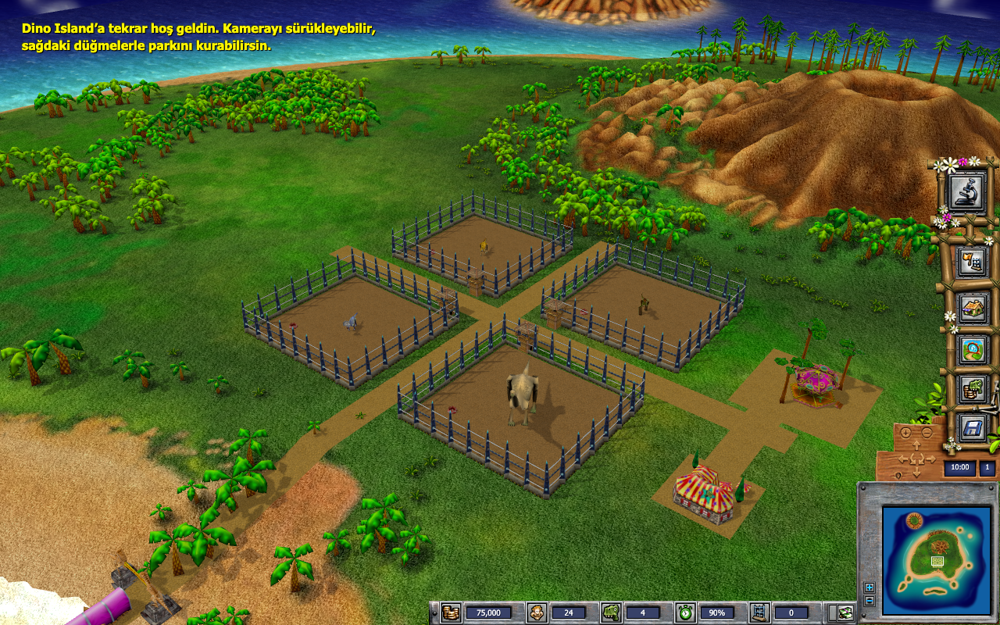

<div align="center">

# 🦕 Dino Island

**A return to a childhood island, this time on macOS.**

Recreating Monte Cristo's 2002 Dino Island in Three.js, while uncovering the original game's file formats and behavior.

[Getting started](#getting-started) · [Controls](#controls) · [Research](#research-and-rea) · [Development](#development-and-testing)


</div>



## Rebuilding an island

Dino Island brings the original game's island data, dinosaur models, animations, and interface atlases into a modern browser. The aim is a macOS-friendly recreation that approaches the original game's appearance, supported by evidence-based research into its formats and behavior.

**This is a work in progress.** It is not a finished port and does not claim exact equivalence. The application runs on Three.js, TypeScript, and Vite; it does not execute the original Windows game. REA/Ghidra supports static research into the original executable.

## On the island today

- **The original world:** `isl01` terrain, height data, textures, 1,536 vegetation placements, water, a six-face skybox, and cloud layers.
- **Four dinosaurs:** Stegosaurus, T-Rex, Triceratops, and Brachiosaurus, using original meshes, skeletons, skin weights, and walk animations. Adornment pieces also come from the original data.
- **A familiar interface:** bamboo menus, counters, and the minimap frame use original atlases. Parts of the park and construction layouts are read directly from INI files.
- **A playable park prototype:** buy dinosaurs, place buildings, feed animals, incubate eggs, control time, and save or load in the browser.
- **Audio and genetic data:** island music enabled through user interaction, the selection sound, and original base genomes with 18 genes and two alleles per gene, preserved in saves.

The starting park was created for this project. Economy, movement, and incubation rules belong to the prototype; they are not presented as recovered original simulation code. Management dialogs, some material and camera behavior, cloud geometry, and visual genetic mixing remain under development. The current scene has been checked in a browser, but full behavioral and visual equivalence has not been established.

## Getting started

### Requirements

- **Node.js:** `22.19+` on 22.x, `24.11+` on 24.x, or `26+`, with `npm`.
- **Python 3 and Pillow:** for asset preparation. The examples below use `uv` to provide Pillow in a temporary environment.
- **ffmpeg:** optional, for converting the original WAV music to MP3. Preparation continues without it, but music is not converted.
- **A WebGL-capable browser** and locally prepared original game data.

### 1. Get the source

```sh
git clone https://github.com/merttcetn/Dino-Island.git
cd Dino-Island
npm ci
```

### 2. Prepare the original data locally

This repository does not distribute the original game, its installer, or a bulk game asset pack. Extract the game files locally from a copy you have the right to use. The project does not include an automatic downloader or installer. The preparation script expects a game directory containing `Data/`:

```text
references/original/game/
├── Data/
└── DinoIsland.exe     # Only needed for REA research
```

Using the default directory:

```sh
UV_CACHE_DIR=/tmp/dino-uv-cache uv run --with pillow python scripts/prepare-assets.py
```

If your files are elsewhere, pass the **parent directory of Data** with `--source`:

```sh
UV_CACHE_DIR=/tmp/dino-uv-cache uv run --with pillow python scripts/prepare-assets.py \
  --source "/path/to/Dino Island"
```

If Pillow is already installed in your Python environment, you can also use `npm run assets:prepare`.

The script converts images to RGBA PNG, creates interface atlas aliases and a path manifest, and copies allowed runtime data files. It copies the selection sound as WAV and converts the music when `ffmpeg` is available. Outputs go into `public/assets/` and `public/original/Data/`. The source directory is left untouched.

Original data, derived assets, and local analysis tools are covered by `.gitignore`. The script does not copy EXE/DLL files into served directories. Do not symlink the game directory into `public/original`.

### 3. Open the island

```sh
npm run dev -- --port 5179 --strictPort
```

Visit **http://127.0.0.1:5179**. The current in-game interface is in Turkish. The first load reads the original assets; use the interface's audio button to enable sound. Saves live in the browser's `localStorage` and are lost if that browser data is cleared.

## Controls

| Action | Control |
| --- | --- |
| Orbit / zoom | Mouse drag / scroll wheel |
| Move the camera | `W A S D` or arrow keys |
| Rotate the camera | `Q` / `E` |
| Return to the island | `F` |
| Pause / resume | `Space` |
| Construction menu | `B` |
| Genetics laboratory | `G` |
| Rotate a building before placement | `R` |
| Cancel / close a window | `Esc` |
| Select a dinosaur / move the camera on the map | Click a dinosaur / the minimap |

Purchases, feeding, incubation, game speed, and saves are managed through the interface.

## Research and REA

[REA](https://github.com/morluto/rea) is used to inspect the original PE32 executable, search strings and references, and decompile functions through Ghidra. REA does not extract the game assets.

Ghidra is not required for ordinary game development. Static research requires a local `DinoIsland.exe`, Ghidra, and a suitable JDK. `scripts/rea.mjs` selects a supported Node version and uses `.tools/ghidra_12.1.4_PUBLIC` and `.tools/jdk-21*/Contents/Home` when available. You can also set the Ghidra location through `GHIDRA_INSTALL_DIR`.

```sh
npm run rea:doctor
npm run rea:inspect
npm run rea:search -- AdornmentData.ini
node scripts/rea.mjs decompile 0x51d0e0
```

The driver saves raw output locally under `research/raw/`. Research output and working notes are kept outside version control.

## Development and testing

```sh
npm test                    # Simulation and original-data parser tests
npm run build               # TypeScript checks and production build
npm run test:browser         # Playwright browser and interaction tests
npm run test:browser:offline # Playwright route-based QA without a listening server
```

Local verification on **October 17, 2026** passed **45 unit tests, all 6 browser tests, and the production build**. Browser tests cover purchases, construction, incubation, saving/loading, and the interface at 800×600. Audio tests check looping against actual audio samples, page-return recovery, and loading the original MP3. Route-based QA also checked four animated dinosaurs, the sky, and camera limits.

Original-data and browser tests require locally prepared assets. The Playwright configuration starts Vite on port `5179` or reuses an existing server. It looks for the installed Chromium or the newest cached Chromium headless shell. Set `PLAYWRIGHT_CHROMIUM_EXECUTABLE` to provide a browser path when needed. These commands do not download a browser. The latest full browser run used a full Chromium executable through this override and completed all six tests in approximately 17 seconds.

Restricted macOS sandboxes may block loopback listening or Chromium's access to Mach services. The `offline` command avoids the listening server requirement, but still needs permission to launch Chromium. Passing unit tests and a build does not establish visual fidelity.

```text
src/
├── main.ts                  # Startup, interactions, audio, and saves
├── scene.ts                 # Three.js scene, camera, and selection
├── simulation.ts            # Prototype park simulation
├── original-models.ts       # Mesh, skin, and animation loaders
├── original-world.ts        # Original island data
├── original-*.ts            # Camera, sky, material, and genetics research
├── park-interface.ts        # Original interface layout parser
└── ui.ts                    # Park interface
scripts/                     # Local asset preparation and research tools
docs/images/                 # Gameplay screenshot
tests/                       # Unit and browser tests
```

---

The Dino Island name and original game assets belong to their respective rights holders. This independent research and recreation project is not an official release of the original game.
